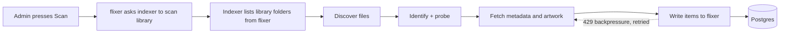

# Indexing flow

1. flixer sends a scan request to the indexer for a library; the library's folders come from the database.
2. The indexer works through queues with configurable worker counts. Admins can pause queues and change concurrency from the dashboard.
3. Results are written back through flixer's indexer endpoints. When too many writes are in flight flixer answers 429 and the indexer retries.
4. Progress is exposed as scan states and surfaced live in the dashboard over the `indexer` WebSocket topic.

Details: [Scanning pipeline](../flixer-indexer/scanning-pipeline.md), [Queues and workers](../flixer-indexer/queues-and-workers.md), [Metadata providers](../flixer-indexer/metadata-providers.md).
