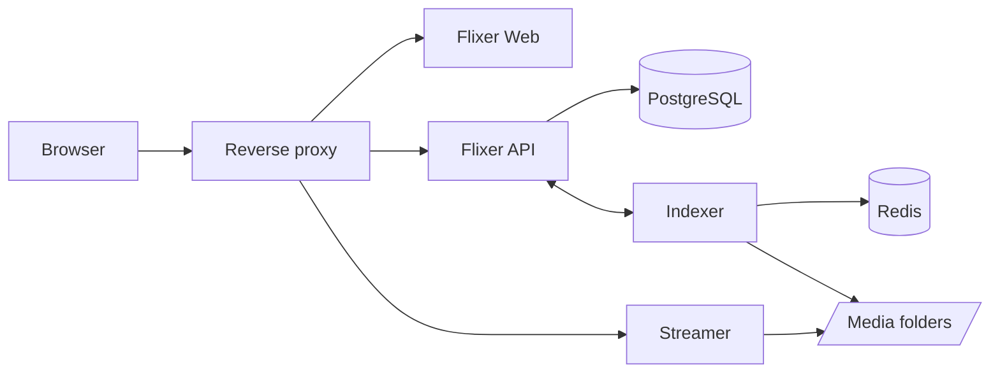

# Architecture overview

Flixer is a set of services deployed together. The web app talks to the API for
accounts, libraries, and playback authorization. Media bytes are delivered by
the streamer, while the indexer scans media and sends catalog results back to
the API.

| Component | Responsibility |
| --- | --- |
| [Flixer](../flixer/overview.md) | Accounts, settings, libraries, catalog, and API. |
| [Flixer Web](../flixer-web/overview.md) | Browsing, account pages, playback controls, and administration. |
| [Flixer Streamer](../flixer-streamer/overview.md) | Reads authorized files and delivers media. |
| [Flixer Indexer](../flixer-indexer/overview.md) | Scans files and enriches catalog entries. |

The standard Compose stack also includes PostgreSQL, Redis, Meilisearch,
[Flixer Logger](../flixer-logger/overview.md), and the
[updater](https://github.com/flixermedia/flixer-updater). AI recommendations
are optional; see the [AI service](../flixer-ai/overview.md).
A reverse proxy presents the web app and service APIs through one address.

## Typical data flow

1. An administrator creates a library from folders under the configured media
   roots and starts a scan.
2. The indexer discovers files, reads local metadata, queries enabled
   providers, and writes catalog entries to Flixer.
3. A user selects an item. Flixer checks access and issues a short-lived
   playback token.
4. The browser sends that token to the streamer, which reads the file and
   returns compatible media.

See [Indexing flow](./indexing-flow.md) and [Playback flow](./playback-flow.md).
