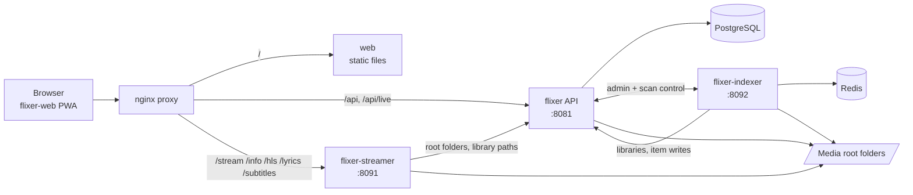

# Architecture overview

## Responsibilities

| Concern | Owner |
| --- | --- |
| Accounts, sessions, passkeys, API keys | flixer |
| Library and share definitions, media metadata, watch history | flixer (Postgres) |
| Which folders exist (`STREAM_MEDIA_ROOT` / `MEDIA_PATH`) | flixer configuration; the streamer and indexer ask flixer |
| Scanning, probing, metadata, artwork, subtitle download | flixer-indexer |
| Serving video, audio, HLS, subtitles, lyrics | flixer-streamer |
| UI and players | flixer-web |

## Communication

- **Browser to API**: REST under `/api` plus WebSockets at `/api/live` and `/api/logs/stream`.
- **Browser to streamer**: direct HTTP to `/stream`, `/info`, `/hls`, `/lyrics`, `/subtitles` using a stream token issued by the API. Bytes never pass through the API.
- **Streamer to API**: fetches library roots and paths, signing the request with `STREAM_TOKEN_SECRET`.
- **Indexer and API**: both directions are signed with `STREAM_TOKEN_SECRET`. The API controls scans and queues; the indexer reads libraries from the API and writes items back, with flixer applying backpressure (`INDEXER_MAX_WRITES`).
- **Redis**: only the indexer's task queue.

## Design principles

1. **One source of truth.** Libraries, shares and settings are in the database; services fetch them rather than duplicating configuration.
2. **Admins define libraries.** Roots are exposed; names and types are chosen in the UI.
3. **Stateless streaming.** The streamer holds no user data; it verifies tokens and serves files.
4. **Push over poll in the UI.** Admin panels subscribe to topics on one WebSocket. See [Real-time updates](../flixer/realtime.md).

See also [Playback flow](./playback-flow.md), [Indexing flow](./indexing-flow.md) and [Security model](./security.md).
