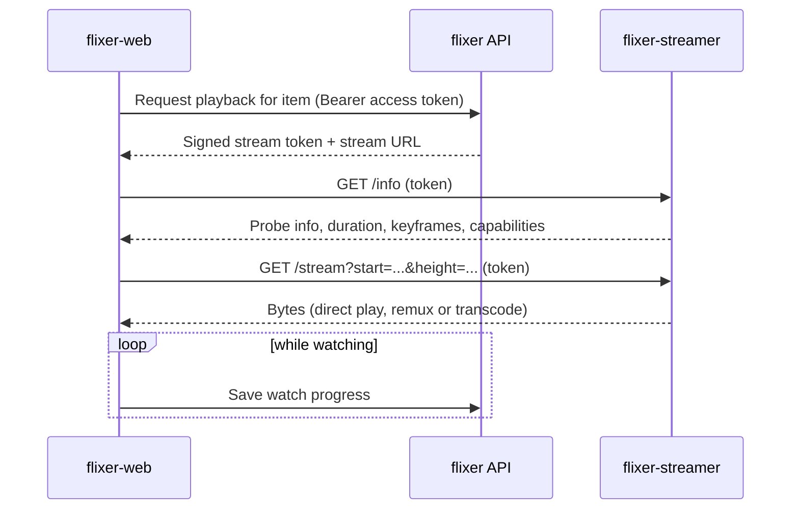

# Playback flow

1. The player asks the API for a stream URL. The API checks the user and returns a short-lived HMAC-signed token (secret: `APP_SECRET`).
2. The streamer validates the token, resolves the file through the library paths it gets from flixer, and chooses a mode. See [Playback modes](../flixer-streamer/playback-modes.md).
3. Seeking restarts the stream at a keyframe-aligned position. The player adds the same offset to subtitle timing so text stays in sync. See [Video player](../flixer-web/video-player.md).
4. Progress is posted to the API and powers continue watching and recently watched on the home page. See [Playback and history](../flixer/playback-and-history.md).
5. Subtitles are served from files stored next to the media; lyrics for music come from the streamer's lyrics endpoint.
