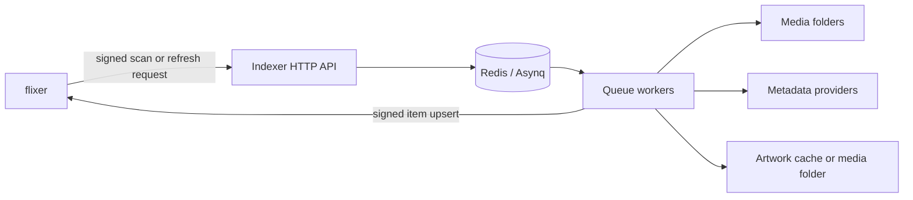
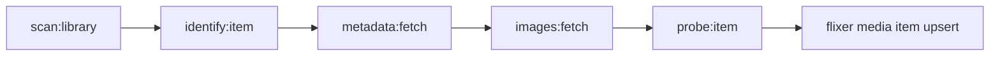

# flixer-indexer overview

`flixer-indexer` is a Go service that discovers media in libraries configured by flixer, reads local metadata, queries enabled metadata providers, downloads artwork, probes media files, and asks flixer to create or update the resulting records. **flixer owns the library configuration and database**; the indexer has no database of its own. Its runtime pipeline is an Asynq task graph backed by Redis.

## Architecture

The indexer exposes the internal API and, depending on `ROLE`, runs queue workers in the same process. `ROLE=all` is the default. `ROLE=api` serves HTTP without starting workers; `ROLE=worker` starts workers and still serves the HTTP API. Redis is required in every role. See [Configuration](./configuration.md), [HTTP API](./http-api.md), and [Queues and workers](./queues-and-workers.md).

## Pipeline and data flow

A library scan is a walk followed by asynchronous item processing:

1. A scan request identifies a flixer library. The indexer fetches its folders and walks their `absolutePath` values.
2. `scanner` turns recognized files and directories into typed items plus filename-derived hints (title, year, series, season/episode, artist, album, IDs).
3. The identify stage reads the applicable local NFO and artwork. Music tracks are probed here as well to read embedded tags and album art-related data; missing lyrics may be fetched.
4. Metadata providers fill fields not supplied locally. Artwork providers contribute candidates; local artwork takes precedence and remote artwork is stored according to the library policy.
5. The final probe stage collects technical media details for videos and persists each item by signed `POST /api/indexer/media/items` to flixer. flixer returns the database ID.
6. When the full scan has finished and all items have settled without failures, the indexer asks flixer to prune records not seen since that scan began.

A refresh re-describes one library path and sends that item through the same pipeline with `Force=true`; it is not a full-library scan. The item identity key prefers a provider ID and uses a root-relative path if no ID is available. For series, seasons, and episodes the indexer also supplies parent keys and provider IDs so flixer can preserve the hierarchy. The key rules are implemented in `internal/models/keys.go`; stage behavior is in `internal/pipeline/handlers.go`.

## Package layout

| Path | Responsibility |
| --- | --- |
| `cmd/flixer-indexer/main.go` | Loads configuration, connects Redis, wires the API, workers, providers, and graceful shutdown. |
| `internal/api` | Authenticated internal HTTP routes, health, task/queue management, images, and subtitle operations. |
| `internal/auth` | Shared timestamped HMAC-SHA256 request signing and verification. |
| `internal/config` | Environment and `.env` loading, queue names, and initial worker defaults. |
| `internal/flixerclient` | Signed calls to flixer for libraries, settings, item upserts, and scan pruning; also contains a stub client. |
| `internal/models` | Shared library, item, metadata, settings, task, and JSON-contract types. |
| `internal/scanner`, `internal/naming` | Filesystem discovery and parsing of supported movie, TV, music, and home-video layouts. |
| `internal/nfo` | Reads local Kodi/Jellyfin-style XML NFO metadata. |
| `internal/probe` | Runs ffprobe and maps streams/tags into technical details. |
| `internal/pipeline`, `internal/progress` | Asynq stage handlers, per-queue worker pools, retry handling, and Redis-backed scan progress. |
| `internal/providers`, `internal/providers/registry`, `internal/providers/*` | Provider interfaces, merge/cache behavior, registry configuration, and provider integrations. |
| `internal/images` | Local artwork discovery, image download/validation, embedded album art extraction, and storage. |
| `internal/lyrics`, `internal/subtitles` | Optional LRC lyrics and OpenSubtitles search/download with sidecar management. |
| `internal/httpx`, `internal/settings` | Shared provider HTTP support/statistics and periodic settings reload from flixer. |

The source of truth for the implementation is the `flixer-indexer` repository. The top-level `README.md` gives the short operational summary; `flixer-indexer-SPEC.md` contains design/contract context and may describe planned flixer-side work, so runtime behavior should be checked against `internal/` and `cmd/`.

