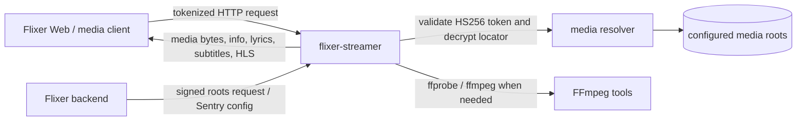

# Flixer Streamer overview

Flixer Streamer is the Go service that reads media from approved local folders and delivers it to Flixer clients. It validates signed playback tokens, resolves encrypted media locators within roots obtained from Flixer, and either serves the original file or runs FFmpeg for remuxing, transcoding, and on-demand HLS segments. It does not own accounts, catalog metadata, a database, playback authorization, or progress persistence. Those responsibilities belong to the Flixer backend and web app.

The service source is under `flixer-streamer/`; `README.md` describes setup and `DESIGN.md` distinguishes shipped behavior from proposed integration work. The HTTP and token contracts below describe the implementation, not the unimplemented playback-info API proposals in `DESIGN.md`.

## Architecture

The service starts its HTTP listener even while the media-root synchronization runs in the background. A valid token is required for media, information, lyrics, subtitles, and HLS requests. `/healthz` is a liveness check and does not require a token.

## Package layout

| Package / file | Responsibility |
| --- | --- |
| `cmd/flixer-streamer/main.go` | Loads configuration, configures JSON logging and optional Sentry, starts root synchronization and the HTTP server, then performs graceful shutdown. |
| `internal/config` | Reads `.env` and process environment settings, validates them, and creates the listen address. |
| `internal/flixer` | Fetches signed root-folder configuration and optional Sentry configuration from Flixer; refreshes roots periodically. |
| `internal/httpserver` | Routes HTTP requests; validates tokens; implements stream, info, HLS, lyrics, subtitle, health, and admin-session handlers; applies CORS and request logging. |
| `internal/token` | Validates the compact HS256 JWT and decrypts the AES-GCM media locator. |
| `internal/media` | Maintains root-ID-to-path mappings and rejects unsafe, missing, non-regular, or root-escaping file references. |
| `internal/transcode` | Probes media, chooses a delivery mode, constructs FFmpeg argument arrays, streams process output, enforces the process limit, and tracks/cancels sessions. |
| `internal/monitoring` | Optionally configures Sentry using settings fetched from Flixer and wraps logging/HTTP handlers. |
| `internal/logfile` | Writes JSON logs to a size-rotated file and normalizes common log attributes. |

Tests live alongside implementations as `*_test.go` files in these packages. The Docker image definition is in `Dockerfile`; the image publishing workflow is `.github/workflows/docker.yml`.

## Request lifecycle

For a typical media request, `internal/httpserver` performs these steps:

1. It checks the request origin when `ALLOWED_ORIGINS` is configured and routes the URL.
2. It validates the token signature and claims using `internal/token`, then decrypts its locator. The client never provides an arbitrary filesystem path.
3. It maps the locator's `rootId` to a configured root and verifies that the relative path resolves to a regular file within that root (`internal/media`).
4. For video playback with FFmpeg available, it probes the source and asks `internal/transcode` to choose DirectPlay, DirectStream, or Transcode. Audio files are served directly by `/stream` without probing.
5. DirectPlay uses Go's `http.ServeContent`, including HTTP byte ranges. Processed playback pipes FFmpeg output to the HTTP response. HLS playlists are generated from the probed duration; each requested segment runs FFmpeg separately.
6. A disconnected client cancels its FFmpeg process. Processed streams are tracked by `playSessionId` for the protected admin endpoints.

The streamer's own Flixer integration is limited to root configuration and optional Sentry configuration fetches. Stream tokens are issued by the flixer API (`src/api/playback/playbackService.ts`); the streamer only validates them and does not verify user authorization itself. (`examples/flixer.env.example` still describes token issuance as pending; that note is out of date.)