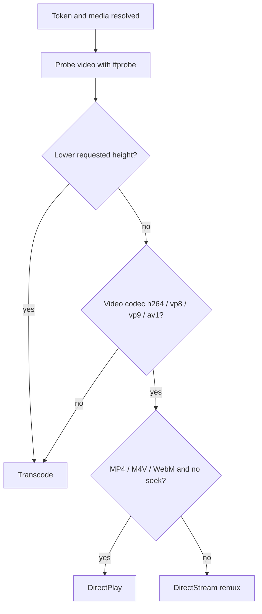

# Playback modes

Playback decisions and FFmpeg arguments are implemented in `internal/transcode/transcode.go`, with routing in `internal/httpserver/handler.go` and HLS segmentation in `internal/transcode/hls.go`. The terms used by the API are `DirectPlay`, `DirectStream` (the implementation's remux mode), and `Transcode`.

## Decision order

When FFmpeg and FFprobe are available, video is probed for the first video stream and first audio stream. The selection logic is:

1. If a lower requested output height requires scaling (or the source height is unknown), choose **Transcode**.
2. If the video codec is not one of `h264`, `vp8`, `vp9`, or `av1`, choose **Transcode**.
3. Otherwise, choose **DirectPlay** only for `.mp4`, `.m4v`, or `.webm` with no positive `start` offset.
4. In other cases (for example MKV, or a seek offset), choose **DirectStream** and remux/copy the video where possible.

This is a server-side heuristic, not a full client-device profile negotiation. It considers the file extension, probed video codec/height, and requested height/offset; it does not enforce token claims such as allowed codecs or bitrates. The first audio and video streams are selected; subtitles and data streams are excluded from progressive FFmpeg output.

If FFmpeg is not found at startup, probing is unavailable. The service continues in a direct-file-serving fallback: `/stream` can serve a request without options directly, even if the container/codec is not browser-compatible. A `height` or `start` option, `/info`, and HLS require the transcoder and return `501` when it is unavailable.

## Containers, codecs, and output

| Mode | Behavior and output |
| --- | --- |
| DirectPlay | Serves the original file with `http.ServeContent`, content type inferred from extension, and HTTP range support. The codec compatibility check is applied when probing is available. |
| DirectStream | FFmpeg stream-copies video into a fragmented MP4 when the video is H.264; VP8, VP9, or AV1 goes into WebM. Audio is copied when it is AAC for MP4 or Opus/Vorbis for WebM; otherwise it is converted to AAC (MP4) or Opus (WebM). |
| Transcode | Re-encodes video to H.264 using `libx264`, `veryfast`, CRF 23, High profile, and `yuv420p`; a lower requested height adds `scale=-2:<height>`. Audio becomes stereo AAC at 160 kbit/s. Output is fragmented MP4. |

The allowed requested heights are 240, 360, 480, 720, and 1080. A request above the source height does not upscale. `availableHeights` in `/info` lists only supported values strictly lower than the probed source height. A request equal to or above the source height does not itself cause scaling. If the video codec is unsupported, the mode can still be Transcode independent of the height choice.

Progressive FFmpeg plans map only `0:v:0` and optional `0:a:0`, and disable subtitle/data streams (`-sn -dn`). Codec/container support depends on the FFmpeg build. There is no hardware acceleration detection or GPU encoder selection: transcoding uses software `libx264`. The Docker image installs FFmpeg, but a local FFmpeg/FFprobe build must also provide the requested encoders and muxers.

## Seeking and keyframe alignment

DirectPlay keeps native byte-range seeking. For a DirectStream seek, the service asks FFprobe for the last video keyframe at or before the requested `start`. It rounds the discovered time to a 10 ms boundary, starts the FFmpeg input about 5 ms before that keyframe, and uses `-copypriorss 0`. This makes the remux begin at the selected keyframe rather than including extra earlier packets from FFmpeg's coarser demuxer seek. `/info` can return the actual `keyframeStart` so the client can align playback UI/subtitles with the stream's real start point. If keyframe lookup fails, it logs a warning and proceeds with the requested offset as a fallback.

Transcode seeks use FFmpeg's input `-ss` at the requested offset and re-encode from there. Processed progressive output is a live pipe, not a range-addressable file; seeking requires a new URL/request with `start`.

## HLS

HLS is implemented as simple VOD segmentation, not adaptive bitrate streaming or a master/variant playlist. The routes are `/hls/{token}/index.m3u8` and `/hls/{token}/{index}.ts`. The playlist divides the probed duration into six-second segments and lists zero-based segment URLs. Each segment request invokes FFmpeg on demand, encodes H.264/AAC into MPEG-TS, and starts a keyframe at the segment boundary. A supported `height` is carried through the playlist query and applied as a scale cap. No segment files are persisted or cached; `TRANSCODE_DIR` is not used by this implementation.