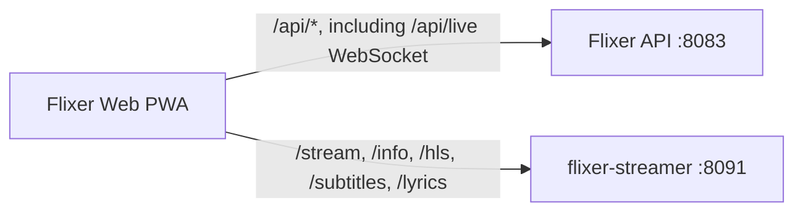

# Flixer Web overview

Flixer Web is the Vue single-page application for browsing and playing a user's Flixer media library. It is a client-side app built with Vue 3 and Vite; the built site is static files, not a server-rendered application. Most library, account, admin, and playback-session operations go to the Flixer API. Actual media bytes, stream metadata, subtitles, and music lyrics are served by the separate flixer-streamer service.

## Stack

- **Vue 3** Composition API with `<script setup>` and TypeScript.
- **Vite 8** builds the app and supplies the development server.
- **Vue Router** provides history-mode routes, lazy-loaded views, and navigation guards.
- **Tailwind CSS v4** (Vite plugin) and the design tokens in `src/tailwind.css` provide styling.
- **vue-i18n** loads nested JSON message catalogs from `src/locales/`.
- **Axios** in `src/api.ts` is the shared HTTP client. State is shared through composables and module-level Vue refs; the current package does not include Pinia.
- **vite-plugin-pwa / Workbox** emits and registers the service worker. Sentry's Vue SDK is initialized only when the API's web monitoring configuration enables it.

## Request flow

In development, the Vite server proxies `/api` (including WebSockets) to `http://localhost:8083`. It proxies `/stream`, `/info`, `/hls`, `/lyrics`, and `/subtitles` to `http://localhost:8091`. The player receives an expiring `streamUrl` from the Flixer API and then uses the streamer routes for stream info and content. These streamer requests use the token embedded in the stream URL rather than the Axios API client. See [Configuration](./configuration.md) for the exact development and deployment behavior.

## Source layout

| Path | Responsibility |
| --- | --- |
| `src/main.ts` | Creates the Vue app, initializes theme and locale, registers router, toasts, modal host, monitoring, and service worker. |
| `src/App.vue` | Root `RouterView`, persistent music mini-player, lyrics overlay, offline banner, and modal target. |
| `src/router/index.ts` | Lazy routes, session validation, admin-role gate, scroll handling, and route titles. |
| `src/views/` | Route-level pages: home, browse/search, media detail, settings/admin, login/verification, and player test. |
| `src/components/home/` | Hero carousel, media rows/cards, mobile tab bar. |
| `src/components/player/` | Video player, player overlay, and app-wide music mini-player. |
| `src/components/admin/` | Admin panels and edit/configuration modals. |
| `src/components/settings/` | Profile, passkey, and language settings. |
| `src/components/ui/`, `src/components/auth/`, `src/components/header/` | Shared UI, account forms, and navigation. |
| `src/composables/` | Shared profile, audio, theme, live updates, notifications, confirmation, subtitles, and navigation behavior. |
| `src/api.ts` | API types, Axios client, auth helpers, and Flixer/streamer request URL helpers. |
| `src/i18n/index.ts`, `src/locales/*.json` | Locale loading and translations. English is the source catalog. |
| `src/tailwind.css` | Tailwind import, custom `page-gutter`, theme tokens, light-theme overrides, and base styles. |
| `public/` | Static browser/PWA assets. `resources/` contains bundled branding and examples. |
| `deploy/nginx.conf`, `Dockerfile` | Static SPA container deployment. |
| `scripts/check-locales.mjs` | Locale catalog structure and placeholder validation. |

The README currently contains older structure/stack descriptions; this page follows the checked-in `package.json` and source (for example, there is no Pinia dependency or `src/stores/` directory).

## Build and PWA output

`npm run build` runs `vue-tsc -b` and then `vite build`. Vite writes the deployable static application to `dist/`; the Docker build copies that directory to `/usr/share/nginx/html`. There is no separate application server in this image.

`src/main.ts` registers the generated service worker immediately. `vite.config.ts` uses `registerType: 'autoUpdate'`, precaches matched JS/CSS/HTML/PNG/WOFF2 assets plus the named favicon and icon assets, and uses `/index.html` as the navigation fallback. `/api/` is excluded from that fallback. Workbox cleans outdated precache generations. SVG assets under `/assets/` are cached first-use for up to 90 days (400 entries); `/api/auth/avatars/` images are cached for up to 30 days (50 entries). Other `/api/` requests are network-only so authenticated API data is not stored in the runtime cache. The PWA manifest sets standalone display, root scope/start URL, Flixer branding, and 192/512px icons.

The cached shell can render offline, but API-backed views still need connectivity for fresh data. `src/router/index.ts` skips remote session validation while offline when a token is already present; this is not an offline data-sync mechanism.
