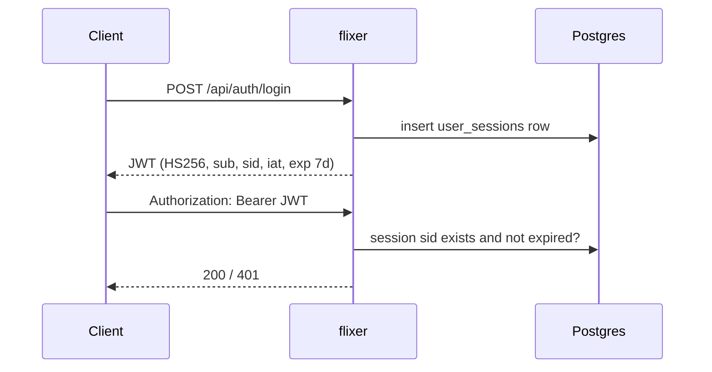

# Authentication

Implemented mainly in `src/api/auth/authService.ts`, `passkeyService.ts`, `emailVerificationService.ts`, `src/api/apiKeys/apiKeyService.ts` and `src/api/auth/mailService.ts` (SMTP).

## Users and passwords

- Usernames: 3–64 chars, `^[a-zA-Z0-9_.-]+$`, stored lowercase. Email is required, lowercased, ≤ 254. Password 8–128 chars. Display name ≤ 64.
- Passwords are hashed with **scrypt** (N = 2^14, 64-byte key, 16-byte random salt), stored as `scrypt$<salt>$<key>` (base64url).
- The **first registered user becomes `admin`** (guarded by the advisory lock `flixer:first-user-admin`). Others are `user`.
- When the `registration_enabled` setting is `false` and users already exist, `POST /api/auth/register` requires an **admin bearer token** (session or API key).
- Disabled users (`disabled_at`) get `403` at login and `401` on any existing token.

## Access tokens and sessions

- Token: HS256 JWT signed with `JWT_SECRET`, claims `sub` (user id), `sid` (session id), `iat`, `exp` (**7 days**).
- Every token is backed by a `user_sessions` row; logging out, deleting a session or an admin revoking sessions makes the token invalid immediately.
- `last_seen_at`, user agent and IP (first `x-forwarded-for` entry) are refreshed at most once per 60 s.
- Expired sessions are purged at startup and hourly by the pg-boss job `cleanup-expired-user-sessions` (cron `0 * * * *`).
- Users list and revoke their own sessions with `GET /api/auth/sessions` and `DELETE /api/auth/sessions/:sessionId`.

## E-mail verification

Verification is **required only if** `smtp_host` is configured **and** `email_verification_required` is not `false`.

- Register then returns `{ "verificationRequired": true, "email": "..." }` and login returns `403` until verified.
- The token is an HMAC-signed value (secret `JWT_SECRET`, purpose `verify-email`, **24 h**) linked as `${APP_URL}/verify-email?token=…`; consumed by `POST /api/auth/verify-email`.
- `POST /api/auth/resend-verification` (body = credentials) has an in-memory 60 s cooldown → `429`.
- Changing your e-mail sets `pending_email` when verification is required.
- Templates are `resources/emails/verify-email.html` and `account-deleted.html` (`{{var}}` substitution, HTML-escaped). Default sender `Flixer <no-reply@localhost>`.

### SMTP

Configured via settings `smtp_host`, `smtp_port` (1–65535), `smtp_secure`, `smtp_user`, `smtp_password`, `smtp_from`. Saving any SMTP setting resets the transporter (`mailService.reset()`). `POST /api/settings/email/test` (admin session) sends a test mail.

## Passkeys (WebAuthn)

Provided by `@simplewebauthn/server`, configured with `PASSKEY_RP_ID`, `PASSKEY_RP_NAME`, `PASSKEY_ORIGINS`.

- Registration needs a bearer token **and the account password** (`POST /register/options`), then `POST /register/verify`. Max **20 passkeys** per user. Attestation `none`, resident key and user verification `preferred`.
- Challenges live in `passkey_challenges` for **5 minutes**.
- **Passwordless login:** `POST /api/auth/passkeys/login/options` + `/login/verify` (usernameless).
- **Second factor:** if `user_preferences.passkey_required` is true and the user has passkeys, password login returns `{ "passkeyRequired": true, "ticket": "…" }`. The ticket (HMAC with `JWT_SECRET`, 5 min) is exchanged through `/second-factor/options` and `/second-factor/verify` for the real token.
- Enabling "passkey required" needs at least one passkey; disabling needs the password (`PATCH /api/auth/me/passkey-required`).

## API keys

- Format `flx_` + 32 random bytes (base64url). Only a **SHA-256 hash** and a 12-char display prefix are stored; the full key is shown **once** on creation.
- Sent as `Authorization: Bearer flx_…`. `last_used_at` is updated at most every 60 s.
- Managed in the admin UI (`/api/admin/api-keys`, admin **session** only – a key cannot create or list keys).

## Roles and admin checks

| Check | Accepts |
| --- | --- |
| Authenticated user | Valid session JWT (or API key where the endpoint uses the generic user check) |
| `requireAdmin` | Admin session **or** API key owned by an admin |
| `requireAdminSession` | Admin session only; API keys are rejected (users, devices, API keys, SMTP test, live sockets) |

## Other account features

- **Delete account:** `POST /api/auth/me/delete` with the password; the last admin cannot delete themselves; the avatar is removed and an "account deleted" mail is sent best-effort.
- **Avatars:** `POST /api/auth/me/avatar` (multipart field `avatar`, ≤ 5 MB, PNG/JPEG/WebP/GIF detected by magic bytes) stored under `DATA_PATH/avatars` as `<userId>-<16hex>.<ext>`, publicly served by `GET /api/auth/avatars/:filename` with immutable cache headers.
- **Preferences:** only `language` is allowed (BCP-47-like, ≤ 35 chars); `null` removes it.

## Stream tokens

When a user starts playback, flixer issues a **stream token** (a 1-hour HS256 JWT, `iss=flixer`, `aud=flixer-streamer`) signed with `APP_SECRET`. The media location is not exposed: it is AES-256-GCM encrypted inside the `mediaLocator` claim, so only the streamer can read it. Details in [Playback and history](./playback-and-history.md).

## Service-to-service signatures

Both indexer↔flixer and streamer→flixer calls use `HMAC-SHA256(APP_SECRET, …)` over a timestamp (±5 min skew) – see [Overview](./overview.md#how-it-talks-to-the-other-services).

## Sentry public config

`GET /api/sentry/config/:app` (`flixer|streamer|web`) is unauthenticated and returns `{ enabled, dsn }`, based on the `sentry_*` settings.
