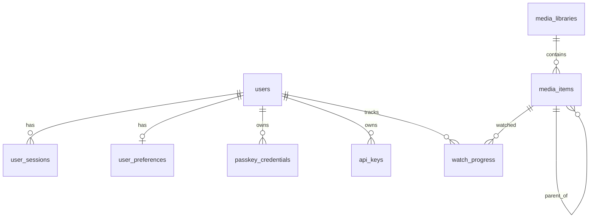

# Database

flixer uses **PostgreSQL** through TypeORM (`src/datasources/defaultDataSource.datasource.ts`, entities in `src/entities/`, migrations in `src/migrations/`).

## Schema management

- `synchronize: false` – the schema is never auto-synced.
- `migrationsRun: false`, but the datasource **explicitly calls `runMigrations()` on initialisation**, so pending migrations are applied at every start.
- Right after migrating it calls `synchronizeSettings()` (seeds `settings.json` under the advisory lock `flixer:sync-settings`) and `cleanupExpiredUserSessions()`.
- Pool size: `DATABASE_POOL_MAX` (default 10).
- **pg-boss** maintains its own `pgboss` schema in the same database (see [Admin API → Jobs](./admin-api.md)).

Migrations in order (timestamp prefixes omitted for brevity): CreateUsersTable, AddUsername, AddUserRole, CreateUserSessions, CreateSettings, CreatePasskeys, AddUserDisplayName, AddUserEmailVerified, AddUserPendingEmail, AddUserPasskeyRequired, AddUserAvatar, CreateUserPreferences, MoveUserSettingsToPreferences, AddDevicesAndApiKeys, AddUserDisabledAt, CreateMediaLibraries, CreateMediaItems, AddMediaItemEditedFields, CreateNetworkShares, AddMediaItemLastSeenAt, CreateWatchProgress.

## ER diagram

`passkey_challenges`, `settings` and `network_shares` have no foreign keys. A share is linked to libraries only through its *root id* (`share-<12 hex>`) stored in a library folder.

## Tables

### `users`
`id` (uuid), `username` (unique, ≤ 64), `display_name`, `email` (unique, nullable, ≤ 254), `role` (`admin`/`user`), `password_hash` (`scrypt$salt$key`), `email_verified_at`, `pending_email`, `disabled_at`, `created_at`. `preferences` is an eager one-to-one.

### `user_sessions`
`id`, `user_id` (FK, cascade), `created_at`, `expires_at`, `user_agent` (≤ 512), `ip_address` (≤ 64), `last_seen_at`. One row per issued access token.

### `user_preferences`
`user_id` (PK/FK, cascade), `data` (jsonb – currently only `language`), `passkey_required`, `avatar_file`, `updated_at`.

### `passkey_credentials` / `passkey_challenges`
Credentials: `id`, `user_id`, `credential_id` (unique), `public_key` (bytea), `counter`, `transports`, `device_type`, `backed_up`, `name`, `created_at`, `last_used_at`. Challenges: `challenge` (PK), `type` (`registration`/`authentication`), `user_id`, `expires_at` (indexed).

### `api_keys`
`id`, `user_id` (FK, cascade), `name`, `prefix` (display), `key_hash` (SHA-256 hex, unique), `created_at`, `last_used_at`.

### `settings`
`id` (serial), `key` (≤ 128, one row per key maintained by settings sync), `value` (jsonb), `is_public`, `updated_at`.

### `media_libraries`
`id`, `name` (unique), `type` (`movies|tvshows|music|homevideos|mixed`), `image_storage` (`cache|alongside`, default `cache`), `folders` (jsonb array of `{rootId, path}`), `created_at`.

### `media_items`
| Column group | Columns |
| --- | --- |
| Keys | `id`, `library_id` (FK → media_libraries, cascade), `parent_id` (self FK, cascade), `external_key` (unique per library) |
| Type | `type`: `movie`, `series`, `season`, `episode`, `album`, `track`, `video` |
| Location | `path`, `root_id`, `relative_path`, `size_bytes`, `modified_at` |
| Titles/numbers | `title`, `sort_title`, `year`, `season_number`, `episode_number`, `episode_end_number` |
| JSON | `provider_ids`, `metadata`, `images`, `technical`, `edited_fields` |
| Flags/timestamps | `nfo_present`, `local_images_used`, `is_placeholder`, `last_seen_at`, `created_at`, `updated_at` |

Indexes: `(library_id, path)` and `(parent_id)`. Tree: series → season → episode, album → track; videos/movies are top level.

### `network_shares`
`id`, `name` (unique), `protocol` (`smb`), `host`, `share`, `username`, `domain`, `password_encrypted` (AES-256-GCM), `read_only` (default true), `created_at`, `updated_at`.

### `watch_progress`
PK `(user_id, item_id)` (both FKs cascade), `position_seconds`, `duration_seconds`, `completed`, `updated_at`; index `idx_watch_progress_user_updated`.

Devices shown in the admin UI are derived from `user_sessions` (user agent/IP), not a separate table.
