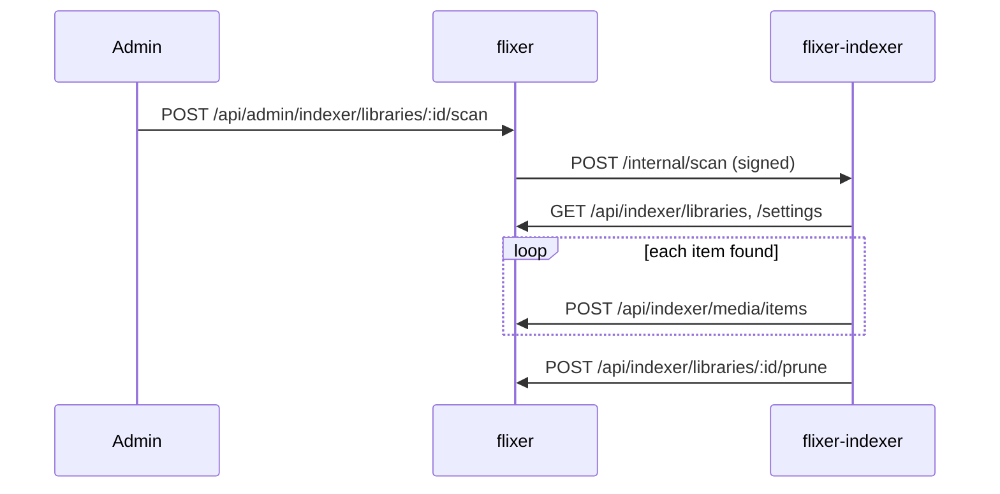

# Libraries and media

## Media roots

A **media root** is a top-level folder the server may read. Roots come from:

1. `STREAM_MEDIA_ROOT` (falls back to `MEDIA_PATH`, then `../flixer-data/media`). Accepts a **JSON array** (`["D:/Movies","D:/Shows"]`), an OS-delimiter-separated list, or a single path.
2. **Connected network shares** (see below), merged in by `NetworkSharesService.roots()`.

`src/api/mediaLibraries/mediaRootsService.ts`:

- Root id = `root-` + first 12 hex chars of `sha256(resolved path)`; name = folder basename. Shares use `share-<12 hex of share uuid>`.
- Paths inside a root are *relative* and validated by `parseRelativePath`: `.`, `..`, `\`, `:` and NUL are rejected.
- `resolveDirectory` uses `realpath` and checks the result stays inside the root (no symlink escapes).
- `browse` lists non-hidden sub-directories, sorted.

The streamer fetches the same list from `GET /api/streamer/media-roots` (HMAC-signed, ±5 min) so ids are identical on both sides.

## Media libraries

A library is DB-backed (table `media_libraries`) and has a name (unique, 1–100), a `type` (`movies`, `tvshows`, `music`, `homevideos`, `mixed`), an `imageStorage` mode (`cache` – artwork in the indexer cache, default; `alongside` – next to the media) and 1–50 **folders** `{ rootId, path }`.

- Folders are validated (must exist inside their root) and de-duplicated on create/update.
- Names are unique → `409` on conflict.
- The admin list adds per folder `rootName`, `location` (absolute path) and `available` (false if the root/folder is offline).
- `MediaLibrariesService.forIndexer()` gives the indexer each folder's `absolutePath`.
- Deleting a library cascades to its `media_items`.

Endpoints: `/api/admin/media-libraries` (see [Admin API](./admin-api.md)).

## Indexing flow

- `POST /api/indexer/media/items` upserts an item in a transaction (`MediaItemsService.upsert`): matches by `external_key`, then by path/type, then by relative key if a library folder moved; links parents (series → season → episode, album → track), creating **placeholder** parents if the parent has not arrived yet.
- Fields an admin edited (`edited_fields`: title, sortTitle, year, season/episode numbers, overview) are **kept** on rescans; manually uploaded images (provider `manual`) are preserved.
- `prune` (called after a clean scan) deletes items of that library not seen since the scan started (with a clock-skew margin) and orphaned placeholders.
- Writes pass through a `WorkLimiter` (`INDEXER_MAX_WRITES`=3 concurrent, `INDEXER_MAX_QUEUED_WRITES`=200 queued, else `429`, which the indexer retries).

## Media items and images

`media_items.images` is a JSON list of `{type, path, provider, ...}`; types used by the UI include `poster`, `backdrop`, `thumb`, `logo`. Images are never exposed by path: clients request `GET /api/media/items/:id/images/:index` (authenticated; `Cache-Control: private, max-age=300`). Files indexed by the indexer are fetched from it (`IndexerClient.fetchImage`); manual uploads live in `MEDIA_IMAGE_DIR` and are referenced as `upload:<filename>` (`src/api/media/mediaImageStorage.ts`).

## Metadata editor (admin)

`/api/admin/media/items…` (`src/api/adminMedia/adminMediaController.ts`):

- `PATCH /items/:id` edits `title`, `sortTitle`, `year`, `seasonNumber`, `episodeNumber`, `episodeEndNumber`, `overview`; edited field names are recorded in `edited_fields`.
- `POST /items/:id/images?type=` uploads an image (multipart field `image`, ≤ 15 MB); `DELETE /items/:id/images/:index` removes one.
- `GET /items`, `GET /items/:id`, `DELETE /items/:id` for browsing/removal.
- Subtitle management endpoints (see [Playback and history](./playback-and-history.md#subtitles)).

## Network shares (SMB)

`src/api/networkShares/*`, table `network_shares`, admin-only (`/api/admin/network-shares`).

- Input: `name`, `host` (hostname/IP), `share` (name only, no slashes), optional `username`, `domain` (needs a username), `password`, `readOnly` (default true).
- Passwords are encrypted with **AES-256-GCM**; the key is derived by HKDF-SHA256 from `STREAM_TOKEN_SECRET` (context `flixer:network-shares:v1`). If the secret changes the password cannot be decrypted and the share reports an error until re-entered.
- **Linux:** `mount -t cifs` under `SMB_MOUNT_DIR/<share id>` (needs root or `SYS_ADMIN`; the password is passed via the `PASSWD` env var, never on the command line). **macOS:** `mount_smbfs`. **Windows:** `net use` and a UNC path.
- Create/update connects first and fails with `400` (secret-redacted message) if it cannot; unique-name conflict → `409`; deleting a share used by a library → `409`.
- Status per share: `connecting`, `connected`, `error`. On startup shares reconnect in the background. `POST /:id/reconnect` retries.
- Responses never contain the password (`hasPassword` only) and expose `rootId`, `location`, `status`, `error`.
- Docker needs `docker-compose.smb.yml` (adds `SYS_ADMIN`, unconfined AppArmor, shared bind propagation for streamer/indexer). The image installs `cifs-utils`. Alternative: mount the share yourself and list that folder in `STREAM_MEDIA_ROOT`.
- Mutations call `live.invalidate("shares", …)` so the admin UI updates instantly.

## Browsing for users

`src/api/media/mediaHomeController.ts` (`/api/media`): `GET /home`, `GET /search`, `GET /browse/:kind` (`movies` → movie+video, `tv` → series, `music` → album), `GET /items/:id` (detail with seasons/episodes or tracks, cast, genres, ratings, technical info). Placeholder items are never returned. Details in [API reference](./api-reference.md).
