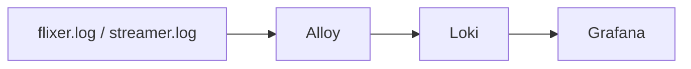

# Observability

## Logging

Configured in `src/config/logger/index.ts` using `@tsed/logger`.

- All Flixer apps share one **unified JSON line** (`src/logs/unifiedLog.ts`):

  ```json
  {"time":"2025-01-01T12:00:00.000Z","level":"info","app":"flixer","source":"<category>","message":"…"}
  ```

  Extra structured fields sit flat beside these. `level` is lowercase `debug|info|warn|error` (`fatal` becomes `error`), ANSI codes are stripped and messages are capped at 4000 chars.
- **Appenders**
  - `live` – mirrors every event into the in-memory live-log hub shown in the admin UI ([Real-time](./realtime.md)).
  - **File** – only when `LOG_DIR` is set: `<LOG_DIR>/flixer.log`, unified JSON layout, rotated at **10 MB** with **3 backups**.
  - **Stdout/stderr** – in production info/debug go to stdout and trace/fatal/error/warn to stderr, both with the unified layout; the route summary at startup is disabled.
- `dotenv` is loaded early in the logger module because it is evaluated before the Ts.ED config.
- Request logging uses `@tsed/platform-log-request`.
- Errors can additionally go to **Sentry** (`src/sentry`); it is active only if `sentry_enabled` and `sentry_flixer_enabled` are true and a DSN is set. These are database settings, editable at runtime.

## LOG_DIR

Point flixer and flixer-streamer at the **same** directory (compose mounts `${LOG_PATH:-../flixer-data/logs}`):

| File | Written by | Consumed by |
| --- | --- | --- |
| `flixer.log` | flixer | Alloy (`app=flixer`) |
| `streamer.log` | flixer-streamer | Alloy (`app=streamer`), flixer's live log tailer |

## Loki / Alloy / Grafana (`docker-compose.observability.yml`)



| Service | Version | Exposure | Notes |
| --- | --- | --- | --- |
| Loki | 3.7.8 | `127.0.0.1:3100` | Filesystem storage, TSDB schema v13, retention **336 h (14 days)** with compactor retention enabled (`deploy/observability/loki.yml`). |
| Alloy | v1.21.0 | UI `127.0.0.1:12345` | Tails `/logs/flixer.log` and `/logs/streamer.log`, extracts `level` as a label, pushes to `http://loki:3100/loki/api/v1/push` (`alloy.alloy`). |
| Grafana | 13.0.11 | `127.0.0.1:3000` | Anonymous Admin access, default dashboard `flixer-logs.json`. Local use only. |

Start it next to the stack:

```bash
docker compose -f docker-compose.yml -f docker-compose.observability.yml up -d
```

## Health checks

flixer has **no dedicated HTTP health endpoint**. Instead:

| Component | Check |
| --- | --- |
| api container (compose) | TCP connect to port `8081`. |
| streamer | `GET /healthz` on `8091`. |
| proxy (nginx) | `GET /healthz` returns `204`. |
| HTTP liveness of flixer | `GET /api/version` returns `{version}` and is public, so it works as a cheap probe. |

PM2 (`processes.config.cjs`) restarts instances above `MAX_MEMORY_RESTART` (750M) and allows `kill_timeout` 30 s for graceful shutdown.

The admin dashboard (`GET /api/admin/overview`) also reports uptime, versions and streamer/indexer reachability.
