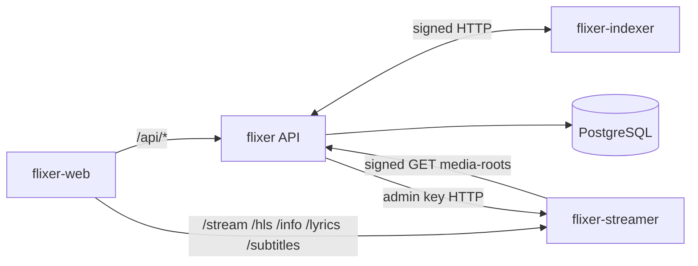

# flixer backend overview

**flixer** is the API server of the Flixer media platform. It is a [Ts.ED](https://tsed.dev) application running on **Fastify**, using **TypeORM** with **PostgreSQL**. Version `1.4.0` (see `package.json`), ESM (`"type": "module"`), built with Vite for Node 24.

It owns the *state and rules* of the platform; the heavy lifting is delegated:

| Service | Responsibility |
| --- | --- |
| **flixer** (this) | Users, sessions, passkeys, API keys, settings, media libraries and the media catalogue (DB), watch progress, stream-token issuance, admin dashboard, live admin sockets. |
| **flixer-streamer** | Serves the actual bytes: direct play, remux/transcode, HLS, subtitles, lyrics. Validates the stream tokens flixer issues. |
| **flixer-indexer** | Scans library folders, identifies media against metadata providers, downloads artwork/subtitles and **writes the results back** to flixer over a signed API. |
| **flixer-web** | The browser UI. |



## Responsibilities

- **Accounts and auth** – registration, login, JWT access tokens backed by DB sessions, passkeys, email verification, API keys, admin roles. See [Authentication](./authentication.md).
- **Settings** – a key/value `settings` table seeded from `src/config/settings.json`; includes SMTP, Sentry and indexer configuration. See [Configuration](./configuration.md).
- **Media libraries** – admin-defined libraries made of folders inside *media roots* (from `STREAM_MEDIA_ROOT` plus connected SMB shares). See [Libraries and media](./libraries-and-media.md).
- **Catalogue** – `media_items` rows (movie/series/season/episode/album/track/video) written by the indexer, edited by admins, browsed by users.
- **Playback** – issues short-lived, signed stream tokens the streamer accepts; stores watch progress. See [Playback and history](./playback-and-history.md).
- **Admin dashboard back end** – overview, streams, devices, indexer control, shares, users, jobs, logs, plus WebSocket push. See [Admin API](./admin-api.md) and [Real-time](./realtime.md).
- **Scheduled jobs** – `pg-boss` queue that purges expired sessions hourly.

## How it talks to the other services

| Direction | Mechanism | Secret |
| --- | --- | --- |
| flixer → indexer (`INDEXER_URL`) | HTTP to `/internal/*`, HMAC-signed headers `x-indexer-timestamp` / `x-indexer-signature` (`src/api/indexer/indexerClient.ts`, `indexerAuth.ts`) | `APP_SECRET` |
| indexer → flixer | `GET /api/indexer/libraries`, `GET /api/indexer/settings`, `POST /api/indexer/media/items`, `POST /api/indexer/libraries/:id/prune` with the same signing scheme (`indexerApiController.ts`) | `APP_SECRET` |
| flixer → streamer (`STREAMER_INTERNAL_URL`) | `GET /admin/sessions`, `DELETE /admin/sessions/:id` with an admin key derived as `HMAC-SHA256(secret, "flixer-streamer:admin:v1")` (`src/api/streams/streamsService.ts`) | `APP_SECRET` |
| streamer → flixer | `GET /api/streamer/media-roots`, signed with `x-streamer-timestamp` / `x-streamer-signature` (`src/api/mediaLibraries/streamerRootsController.ts`) so root IDs always match | `APP_SECRET` |
| client → streamer | HS256 stream token issued by flixer (`src/api/playback/playbackService.ts`) | `APP_SECRET` |

The same `APP_SECRET` (≥ 32 bytes) must therefore be configured identically on flixer, flixer-streamer and flixer-indexer.

## Tech stack

- **Framework:** Ts.ED 8 (`@tsed/di`, `@tsed/platform-fastify`, `@tsed/schema`, `@tsed/ajv`, `@tsed/scalar`, `@tsed/platform-multer`).
- **Fastify plugins:** `@fastify/accepts`, `@fastify/cookie`, `@fastify/formbody`, `fastify-raw-body` (raw bodies are needed for indexer signature checks).
- **DB:** TypeORM + `pg`, migrations in `src/migrations`. Background jobs: `pg-boss`.
- **Auth libs:** Node `crypto` (scrypt, HMAC), `@simplewebauthn/server`, `nodemailer`.
- **Realtime:** `ws`.
- **Errors:** `@sentry/node` (configured through DB settings).
- **Tooling:** TypeScript, Vite SSR build, Vitest, Prettier, Husky.

## Project layout

```text
src/
  index.ts                 process entry: free port, bootstrap, graceful shutdown
  server.ts                Ts.ED @Configuration (mount /api, Scalar, Fastify plugins)
  api.ts                   list of all controllers mounted under /api
  config/                  config sources, logger, settings.json, settingsSync.ts
  datasources/             defaultDataSource.datasource.ts (Postgres + migrations)
  entities/                TypeORM entities
  migrations/              TypeORM migrations
  jobs/                    pg-boss scheduler (JobScheduler)
  live/                    /api/live admin WebSocket (LiveHub, LiveService)
  logs/                    /api/logs/stream socket, unified log format, streamer log tailer
  sentry/                  SentryService, SentryController, error filter
  api/
    adminMedia/ adminUsers/ apiKeys/ auth/ devices/ indexer/ jobs/
    mediaLibraries/ media/ networkShares/ overview/ playback/
    preferences/ settings/ streams/ version/
resources/emails/          HTML e-mail templates
deploy/                    nginx proxy + observability (Loki/Alloy/Grafana) configs
scripts/                   kill-port, format, insomnia export, commit-message hook
```

Each feature folder under `src/api/<feature>` normally contains a `*Controller.ts`, a `*Service.ts` and request DTOs (`*Request(s).ts`).

## Startup / bootstrap

1. `src/index.ts` resolves the port (`PORT`, default `8083`) and, **in development only**, runs `scripts/kill-port.mjs` if it is busy (`src/config/freePort.ts`).
2. `PlatformFastify.bootstrap(Server)` builds the Ts.ED application defined in `src/server.ts`:
   - imports `DefaultDataSource`, `JobScheduler`, `SentryService`, `LiveLogService`, `LiveService`;
   - mounts every controller from `src/api.ts` under **`/api`**;
   - serves Scalar OpenAPI docs at `/scalar/doc`;
   - accepts `application/json` only (`acceptMimes`); multipart is handled per-route by `@tsed/platform-multer`.
3. On datasource init, `DefaultDataSource` **runs all pending migrations**, then `synchronizeSettings()` (seed `settings.json` defaults) and `cleanupExpiredUserSessions()`.
4. `JobScheduler` starts pg-boss; `NetworkSharesService.$onInit` reconnects saved SMB shares in the background (it does not block startup).
5. When the HTTP server is listening, `LiveService` and `LiveLogService` attach their WebSocket upgrade handlers (`$onReady`).
6. A bootstrap failure is logged as `SERVER_BOOTSTRAP_ERROR` and the process exits with code 1. `SIGINT`/`SIGTERM` trigger a graceful `platform.stop()`.

In Docker the app runs under **PM2** in cluster mode (see [Observability](./observability.md) and [Development](./development.md)).
