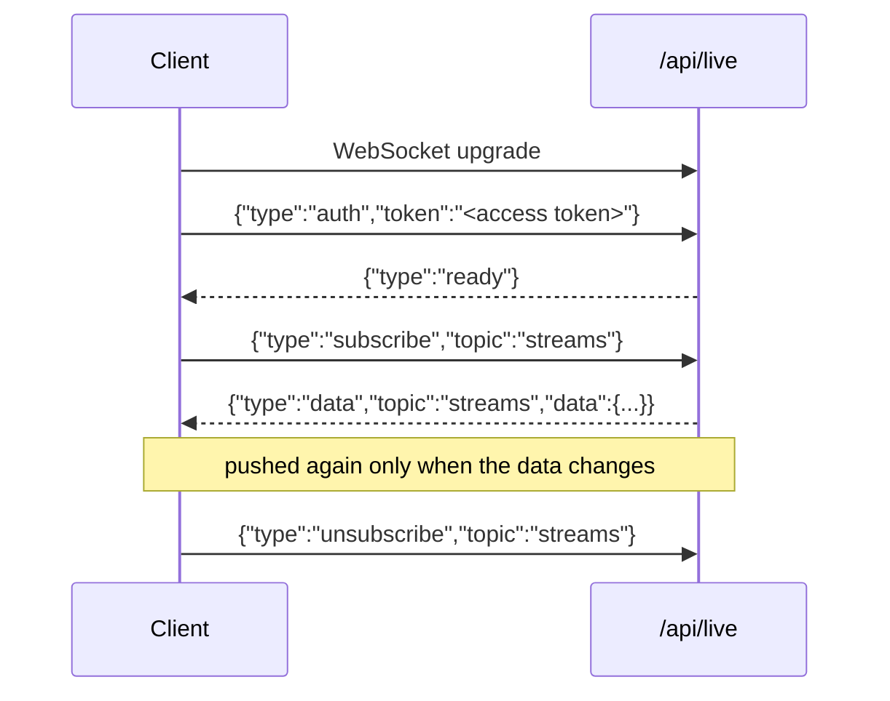

# Real-time

flixer exposes two raw WebSockets (library `ws`), attached to the HTTP server's `upgrade` event in `$onReady`. Both are **admin-session only** (API keys are not accepted on `/api/live`; the log socket uses `requireAdmin`). Browsers cannot send an `Authorization` header on a WebSocket and tokens in URLs leak into proxy logs, so the **access token is sent as the first message**.

## `/api/live` – admin dashboard push

Code: `src/live/liveHub.ts`, `liveService.ts`, `liveSocketServer.ts`.

### Topics

| Topic | Data | Poll interval | Per session |
| --- | --- | --- | --- |
| `overview` | dashboard overview (`OverviewService.get()`) | 10 s | no |
| `streams` | streamer sessions (`StreamsService.fetchSessions()`) | 2 s | no |
| `devices` | device list, marking the caller's session (`DevicesService.list`) | 15 s | **yes** |
| `indexer` | indexer status (`AdminIndexerService.status()`) | 2 s | no |
| `shares` | network shares (`NetworkSharesService.list()`) | 3 s | no |

### Protocol



| Client message | Meaning |
| --- | --- |
| `{"type":"auth","token":"…"}` | Must be the first message, within **5 s**. |
| `{"type":"subscribe","topic":"…"}` | Subscribe (ignored if already subscribed or topic unknown). |
| `{"type":"unsubscribe","topic":"…"}` | Unsubscribe. |

| Server message | Meaning |
| --- | --- |
| `{"type":"ready"}` | Authentication accepted. |
| `{"type":"data","topic","data"}` | Current data right after subscribing, then on every change. |

### Close codes

| Code | Meaning |
| --- | --- |
| `4401` | Unauthorized: invalid/missing auth message, auth timeout, bad/expired token. **Do not reconnect with the same credentials.** |
| `4403` | Forbidden: valid user but not an administrator (or disabled). Do not reconnect. |
| `1013` | Client too slow (> 4 MiB buffered). |
| `1001` | Server shutting down. |

HTTP `503` is returned on upgrade when 50 clients are already connected.

### Limits and behaviour

- Max **50** clients, client messages ≤ 4 KiB, heartbeat ping every 30 s (unresponsive sockets are terminated).
- Tokens are **re-validated every 60 s**; revoked sessions/roles are closed with 4401/4403.
- **LiveHub**: a topic is only loaded while someone is subscribed; one load per interval regardless of subscriber count; a message is only sent when the JSON differs from the last one; a late subscriber immediately gets the cached data. A failed load keeps the last data and retries on the next tick.
- `LiveService.invalidate(...topics)` forces an immediate refresh; controllers call it after mutations (devices, streams, shares, indexer actions, overview).

:::caution Proxy note
`deploy/proxy/nginx.conf` defines dedicated WebSocket-upgrade locations (`Upgrade`/`Connection` headers, 1 h read timeout, no buffering) for `= /api/live`, `= /api/logs/stream` and `/socket.io/`. Any other reverse proxy in front of flixer must do the same, or live updates will not connect.
:::

## `/api/logs/stream` – live logs

Code: `src/logs/liveLogSocketServer.ts`, `liveLogHub.ts`, `liveLogService.ts`, `streamerLogTailer.ts`.

Protocol: send `{"type":"auth","token":"<access token>"}` first (5 s timeout). The server replies:

```json
{ "type": "snapshot", "entries": [ /* last ≤ 500 entries */ ] }
{ "type": "log", "entry": { "id": 1, "time": "ISO", "level": "info", "app": "flixer", "source": "…", "message": "…", "fields": {} } }
```

- Same close codes (4401/4403, 1013, 1001) and 60 s re-validation; max **10** clients; send buffer limit 1 MiB.
- `LiveLogHub` is an in-memory ring buffer of 500 entries fed by the `live` log appender (`liveLogAppender.ts`) – flixer's own logs.
- If `LOG_DIR` is set, `StreamerLogTailer` polls `<LOG_DIR>/streamer.log` every 500 ms (survives rotation/truncation, reads the last 32 KiB at start) and republishes each JSON line with `app: "flixer-streamer"` unless the line has its own `app`. Non-JSON lines become `info` text.
- Log levels are normalised to `debug | info | warn | error`; messages are truncated to 4000 chars.
- nginx has a dedicated location with 1 h read timeout and `proxy_buffering off`.
